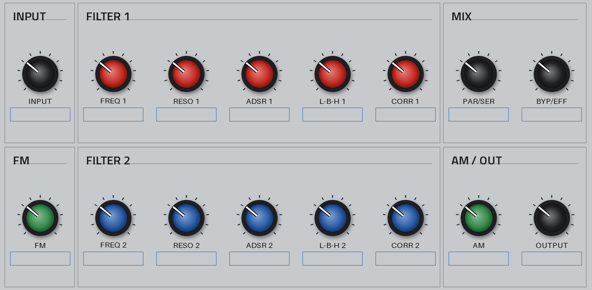
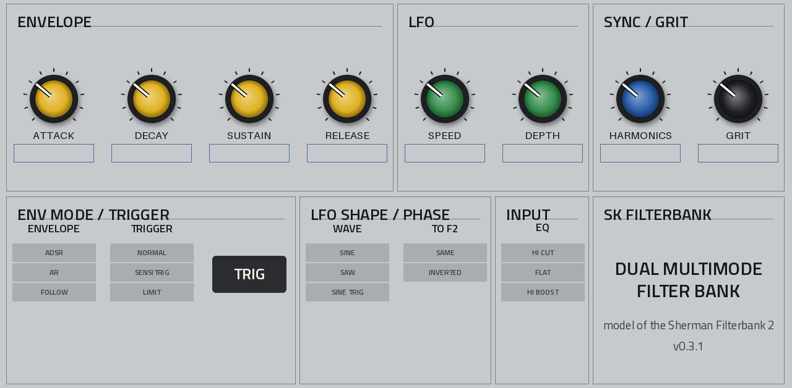
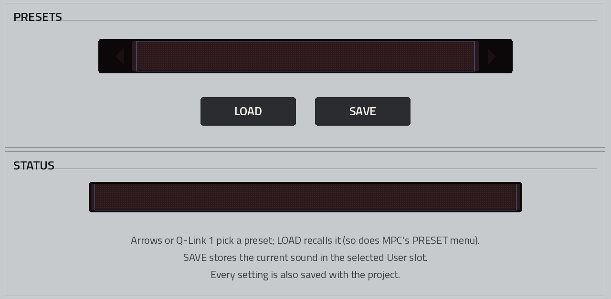

# SK Filterbank on the Akai Force (MPC OS 3.9, MockbaMod)

The filter runs on the Force as a **native insert effect** with three touchscreen pages, Q-Links, presets in MPC's
PRESET menu, and its full state saved with your project. MPC OS has a VST2 host built in: a JUCE plugin loader that
Akai uses for its own plugins. Community tooling ([mpc-vst-plugins](https://github.com/sd88me/mpc-vst-plugins), MIT)
worked out how third-party plugins can use it. Root access is needed to register a plugin, and MockbaMod provides it
over SSH.

| FILTERS | MODULATION | PRESETS |
|---|---|---|
|  |  |  |

*Offline previews of the pages. On the device MPC draws the names and values itself (the boxes under the knobs) in
its own font, using the plugin's parameter names, for example "LFO Speed".*

## What you need

- An **Akai Force** (Gen1, 32-bit ARM) on **MPC OS 3.x**. Built and checked against the facts the community verified on
  a Force running MPC OS 3.9.1. Gen2 devices (MPC Live III and later, 64-bit) need a different build.
- **MockbaMod** for your firmware. For Force FW 3.5 and later it is distributed through the
  [MockbaMod Discord](https://discord.gg/HvNBpArSSa), not the GitHub page. MockbaMod gives you SSH/SFTP as root.
- A computer on the same network as the Force, with `ssh`/`scp`. On Windows, PuTTY and WinSCP work too.

## Install

1. Download `dist/SK-Filterbank-0.3.1-mpc-armv7.zip` from this repo.
2. **Save your project.** The installer stops MPC and starts it again.
3. Copy the zip to the Force and run the installer:
   ```sh
   scp SK-Filterbank-0.3.1-mpc-armv7.zip root@<force-ip>:/tmp/
   ssh root@<force-ip>
   cd /tmp && unzip -o SK-Filterbank-0.3.1-mpc-armv7.zip && sh SK-Filterbank-0.3.1/install.sh
   ```
   The installer is the toolkit's tested one:
   - It checks the device and stops MPC (the `acvs` or `inmusic-mpc` service).
   - It copies the plugin folder to `/sdcard/Synths/Sher Khan - VST - SK Filterbank/`.
   - It backs up `MPC.settings` (as `MPC.settings.bak-sk_filterbank-<date>` next to it) and adds one entry to MPC's
     plugin list (`pluginList-arm`), refusing to save an edit that isn't valid.
   - It starts MPC again.

   Running it again upgrades in place and **keeps your User presets** (the `presets/` folder).
4. On the Force, add **SK Filterbank** (manufacturer *Sher Khan*) to a track's insert effects from the plugin effects.
   The FILTERS / MODULATION / PRESETS tabs at the bottom switch pages, and the Q-Links follow the page.

Upgrading from 0.2.0 or 0.3.0: projects and User presets carry over unchanged (same controls, same saved state). Upgrading
from 0.1.0: the controls changed completely, so a project saved with 0.1.0 opens with this plugin at its Init sound.

Install on the internal drive (the default). A Force SSD is usually mounted `noexec`. MPC then lists the plugin but can
only show "Load Plugin", because it can't load code from that drive.

If you use MockbaMod's VST scanner (`vstscanner.sh`), it rebuilds the plugin list from the `plugin-meta.xml` files in the
`Synths` folders. This plugin folder has one, so it survives a rescan.

### Uninstall

```sh
ssh root@<force-ip> sh /tmp/SK-Filterbank-0.3.1/uninstall.sh
```
(If `/tmp` was cleared by a reboot, copy and unzip the package again first.) This stops MPC, removes the plugin and its
plugin-list entry (after a backup), and starts MPC. Your `presets/` folder is kept. Projects that used the plugin open
without it.

## Your settings and presets

- **With the project, automatically.** Every control is saved in the plugin's state when you save the project or the
  track program, and restored when you load it. There is no separate step: move a knob, save the project, and it comes
  back that way. The preset you last picked is saved too. MPC re-selecting that preset when the project opens doesn't
  overwrite your tweaks.
- **MPC's PRESET menu** lists the 12 factory sounds and the 16 User slots. Picking one loads it. Picking the one that
  is already selected does nothing (that's what protects a project's tweaks), so to go back to a preset after
  tweaking it, press LOAD on the PRESETS page.
- **During playback**, a preset (from the menu or LOAD) crossfades from the old sound to the new one in 30 ms. If you
  pick another one within those 30 ms, it follows straight after. A project load still applies at once.
- **PRESETS page:**
  - The arrows (or Q-Link 1) pick a preset, and **LOAD** recalls it.
  - **SAVE** stores the current sound in the selected User slot. Factory presets are read-only, and the status line
    says what happened.
  - User presets are small text files in `/sdcard/Synths/Sher Khan - VST - SK Filterbank/presets/` (`user_01.skfb` to
    `user_16.skfb`). Back them up or copy them to another Force like any file.
  - MPC itself has no "save preset" for third-party plugins, so saving happens on this page.

Factory presets: Init, Acid Squelch, Funk Follower, Twin Notch Sweep, Stereo Wobble, Vowel Bank, Drum Crusher,
Screaming Ring, Audio FM Growl, Sub Rumble, Harmonic Pluck, Slow Motion.

## What's new in 0.3.1

Less CPU again. Controls and saved state are unchanged.

- **Silence costs almost nothing.** MPC keeps calling insert effects on silent tracks and with the transport
  stopped. 0.3.0 ran the full DSP on that silence; 0.3.1 sleeps.
  - It sleeps after 256 samples (6 ms) of input under -140 dBFS, once its output has died away under -90 dBFS and
    nothing in it can sound by itself: no self-oscillation, envelope at rest, no knob gliding.
  - Asleep, it outputs exact silence and skips the DSP: 5,400 instructions per 128-frame block instead of 212,000.
  - Any input, knob change or TRIG wakes it at once, with the filters at rest, as if freshly loaded.
- **Faster while playing.** The NEON path now processes 32 samples at a time instead of one. Instructions per
  128-frame block, counted on the ARM build under emulation:

  | Sound | 0.2.0 | 0.3.0 | 0.3.1 |
  |---|---|---|---|
  | Init | 513k | 221k | 170k |
  | Acid Squelch-like (envelope sweep, grit) | | 269k | 210k |
  | Audio FM Growl-like | | 264k | 225k |
  | Screaming Ring-like (self-oscillation, AM) | | 233k | 180k |
  | Drum Crusher-like (+28 dB, grit, Limit) | | 292k | 217k |

  - Heavy drive no longer drops into slow plain code: every case of the overdrive's anti-aliasing now runs in NEON,
    including steps that cross the clipper's knee, with no division.
  - Without NEON (not the Force) the plain path is about 5% slower than 0.3.0 while playing, and sleeps in silence.
- **One sound change: grit's clock bleed is now heard only while the clock itself is audible.**
  - That means cutoffs under about 200-400 Hz, where the clock (50 times the cutoff) is under 10-20 kHz. Above
    that the real chip's clock is ultrasonic.
  - The plugin's square wave up there only aliased down into an input-independent whine. With the default
    settings it was about -72 dBFS on silent input; with Grit at 100% and a cutoff around 600 Hz, up to about
    -55 dBFS.
  - That whine is gone, which is also what lets the default sound sleep. Grit's sampling, the folding of high
    content at low cutoffs, is unchanged.

## What's new in 0.3.0

The controls and the saved state are the same as in 0.2.0. The work went into CPU and into how changes sound while
the music plays.

- **Less CPU.**
  - Counted instruction by instruction on the ARM build under emulation, one 128-frame block takes 220,000
    instructions with NEON (the Force's processor has it). 0.2.0 took 513,000, so that is 57% fewer.
  - Without NEON it takes 310,000 (40% fewer).
  - With NEON the audio path makes no divisions (0.2.0 made 46 per sample; the plain path makes 10). It makes no
    math-library calls either, except on rare large steps of the overdrive (0.2.0 made at least four per sample).
    Both are slow on the Force's processor.
  - None of this is timed on a Force yet; run the bench below.
- **No clicks from switches.**
  - Switching LIMIT, HARMONICS (free/locked), LFO F2 or the LFO shape while the music plays used to jump by 8 to 16
    times the signal's normal step. Now it stays within 1 to 2 times (the tests check it).
  - A SINE TRIG restart now glides for 2 ms instead of jumping.
- **Smooth preset changes.** See above: a 30 ms crossfade instead of every knob sweeping to its new value.
- **Smoother knobs.** Freq 1/2 and the harmonic ratio glide over 30 ms (the other knobs over 15 ms). A Q-Link
  turned slowly sweeps instead of stepping.
- **Three small sound changes.**
  - The output safety limiter is exactly linear up to 0 dBFS. 0.2.0's took 0.16 dB off a full-scale signal.
  - With LIMIT on, AM and the clock bleed sound the same as with it off.
  - Aliasing at high drive dropped a little (-76 instead of -71 dBc at +30 dB).

## The controls

The controls follow the Filterbank 2's front panel as its manual excerpts and reviews describe it. Each page row is one
Q-Link bank (Force knobs 1-8).

**FILTERS page**

| Bank | Knobs 1-8 |
|---|---|
| 1 | Input, Freq 1, Reso 1, ADSR 1, L-B-H 1, Corr 1, Par/Ser, Byp/Eff |
| 2 | FM, Freq 2, Reso 2, ADSR 2, L-B-H 2, Corr 2, AM, Output |

**MODULATION page**

| Bank | Knobs 1-8 |
|---|---|
| 1 | Attack, Decay, Sustain, Release, LFO Speed, LFO Depth, Harmonics, Grit |
| 2 | Env Mode, Trig Mode, –, LFO Shape, LFO F2, Input EQ, –, – |

On the MODULATION page the bottom-row switches step one position per Q-Link click, and the TRIG button sits between
them.

| Control | What it does |
|---|---|
| Input | -30 dB to +40 dB, unity at noon. Past noon it saturates, then distorts. It is also the trigger sensitivity, as on the unit |
| Input EQ | Hi Cut / Flat / Hi Boost shelf at 2.5 kHz, before the drive |
| Freq 1 / 2 | 20 Hz to 40 kHz |
| Reso 1 / 2 | Filter 1 only just reaches self-oscillation ("partial", as the manual says). Filter 2 screams from about 88% |
| ADSR 1 / 2 | Envelope depth: filter 1 0 to +6 octaves, filter 2 bipolar ±6 octaves |
| L-B-H 1 / 2 | Continuous lowpass > bandpass > highpass |
| Corr 1 / 2 | Correction: left adds band-pass, centre is off, right subtracts it and adds LP+HP, so BP + full right is a notch |
| Par/Ser | Continuous blend from parallel (1 + 2) to serial (1 into 2) |
| Harmonics | Free, or filter 2 locked to filter 1 at 1:1, 2:3, 1:2, 1:3, 1:4, 1:5, 1:6, 1:8, 1:10, 1:12, 1:16. Freq 2 then reads "Locked" |
| Attack / Decay / Sustain / Release | 1 ms-5 s / 5 ms-10 s / bipolar ±100% / 5 ms-10 s |
| Env Mode | ADSR (held while the input is above the trigger level), AR (one shot per trigger), Follow (envelope follower; Sustain sets its sensitivity) |
| Trig Mode | Normal; SensiTrig (twice as sensitive); Limit (gives the filters 6 dB more headroom when the input is overdriven) |
| TRIG | Fires the envelope by hand (and restarts a Sine Trig LFO) |
| LFO Speed / Depth | One cycle a minute up to 3 kHz (audio rate) / bipolar ±4 octaves |
| LFO Shape / LFO F2 | Sine, Saw, Sine Trig (restarts on each trigger) / filter 2 moves with filter 1 or opposite |
| FM | The input audio sweeps both cutoffs |
| AM | The output is amplitude-modulated by filter 2's output (try it with Reso 2 self-oscillating) |
| Byp/Eff | Dry/wet. The dry signal is delay-compensated, so there's no comb filtering |
| Output, Grit | Plugin additions: output level, and how much of the switched-capacitor sampling (below ~1.7 kHz cutoff) and clock bleed (below ~400 Hz, where the clock is audible) you hear |

The plugin reports 36 samples (0.8 ms) of latency. That is the 4x oversampling filters.

## Built and checked so far

| Check | Result |
|---|---|
| DSP tests (`make test`, and on the ARM build under qemu-arm) | 49/49: unity at noon, filter slopes, notch from the Correction knob, resonance, filter 2 self-oscillation, harmonic lock, Par/Ser, Hi Cut/Boost, ADSR/AR/follower, SensiTrig, TRIG, LFO rate, AM and FM sidebands, grit, aliasing, no clicks from switches and knobs, sleep in silence and waking on input, knob change and TRIG (never while self-oscillating or with an audible clock bleed), NaN safety, stress. On ARM, NEON and the plain path agree to -113 dB |
| VST2 host test, x86 and the **real ARM binary under qemu-arm** (with and without NEON) | 51/51: parameters and value texts, Q-Link nudges on switches, the PRESET menu, user preset save/load, buttons springing back, the project chunk with the preset, chunk-load jumps, a mid-note preset crossfade without a click, host updates spread over blocks, in-place buffers, presets folder found next to the `.so` |
| Binary | armv7 hard-float, exports only `VSTPluginMain`, needs only libc/libm, highest glibc symbol 2.29 (the Force has 2.39) |
| Installer | install, upgrade and uninstall under BusyBox 1.36.1 (the Force's version) against a mock `MPC.settings`: one entry, other plugins untouched, User presets kept on upgrade and uninstall |
| CPU | ARM instructions per 128-frame block (counted under qemu), Init: 170k with NEON (0.3.0: 221k, 0.2.0: 513k), 326k without; 5.4k when asleep in silence. On an x86 VM the toolkit's bench idles at 2.0% of a block (0.3.0: 2.5%, 0.2.0: 3.3%). **Not timed on a Force** |

**Not verified:**
- Loading on a real Force.
- The pages and knob art on the real screen, the PRESET menu and project reload on the device.
- CPU on the RK3288.
- The sound and the panel colours against a real Filterbank 2. The knob colours are a guess at its function coding;
  edit `KNOB_COLOURS` in `skin_post.py` to change them.

Please run the device CPU check before relying on several instances:

```sh
MPC_VST=../mpc-vst-plugins mpc/bench.sh <force-ip>       # PASS / WARN / FAIL, nothing is installed
```

Read its "idle" and "audio in" rows for the plugin's own cost (the bench feeds noise even in "idle", so it never
shows the sleep in silence). Its sweep rows set random parameters every block,
including LOAD and SAVE. So they also time preset files being written and read, and preset crossfades, where two
sounds run side by side. On MPC those buttons are pressed from the screen, not on the audio thread, and only now and
then.

## Troubleshooting

- **Listed, but only "Load Plugin":** usually installed on a `noexec` drive. Reinstall to the default `/sdcard/Synths`.
- **Gone from the list after a restart:** something rewrote MPC's plugin list. Causes include an edit made while MPC was
  running, or a tool that rebuilds the list. Run `install.sh` again.
- **Changed the skin?** MPC caches skins, so restart MPC (re-inserting the plugin is not enough).
- **SAVE says "Could not save":** the plugin folder isn't writable (for example, it was installed on a read-only
  location). Reinstall to `/sdcard/Synths`.
- **MPC crashes when the plugin loads:** SSH in, run `uninstall.sh` (or restore the `MPC.settings` backup), and open an
  issue with the MPC OS version.

## Rebuilding

```sh
sudo apt install g++-arm-linux-gnueabihf qemu-user python3-pil   # Debian/Ubuntu
git clone https://github.com/sd88me/mpc-vst-plugins ../mpc-vst-plugins
git -C ../mpc-vst-plugins checkout 3a54b72cd172c840881b0be4f887653cc0829bf0
mpc/build.sh 0.3.1          # tests (x86 and ARM), Force build, binary checks, skin, dist/SK-Filterbank-0.3.1-mpc-armv7.zip
```

Files:
- `sk_vst.cpp`: the VST2 wrapper (float audio, hand-written ABI, presets, state).
- `params.json` and `layout.conf`: the pages and Q-Links.
- `skin_post.py`: the colour-coded knobs and page texts.
- `check_params.py`: keeps the files above in step with the plugin, since saved projects bind parameters by index.
  Never reorder them, only append.
- `build.sh` and `bench.sh`: the build and the device CPU check.
