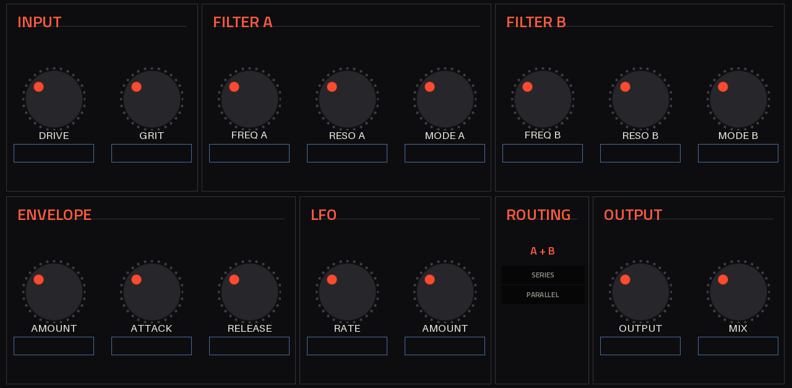

# SK Filterbank on the Akai Force (MPC OS 3.9, MockbaMod)

The filter runs on the Force as a **native insert effect** with its own touchscreen page and Q-Link map. MPC OS has a VST2
host built in: a JUCE plugin loader that Akai uses for its own plugins. Community tooling
([mpc-vst-plugins](https://github.com/sd88me/mpc-vst-plugins), MIT) worked out how third-party plugins can use it. Root
access is needed to register a plugin, and MockbaMod provides it over SSH.



*Offline preview of the page. On the device MPC draws the names and values itself (the boxes under the knobs) in its
own font, using the plugin's parameter names, for example "Env Amount".*

## What you need

- An **Akai Force** (Gen1, 32-bit ARM) on **MPC OS 3.x**. Built and checked against the facts the community verified on
  a Force running MPC OS 3.9.1. Gen2 devices (MPC Live III and later, 64-bit) need a different build.
- **MockbaMod** for your firmware. For Force FW 3.5 and later it is distributed through the
  [MockbaMod Discord](https://discord.gg/HvNBpArSSa), not the GitHub page. MockbaMod gives you SSH/SFTP as root.
- A computer on the same network as the Force, with `ssh`/`scp`. On Windows, PuTTY and WinSCP work too.

## Install

1. Download `dist/SK-Filterbank-0.1.0-mpc-armv7.zip` from this repo.
2. **Save your project.** The installer stops MPC and starts it again.
3. Copy the zip to the Force and run the installer:
   ```sh
   scp SK-Filterbank-0.1.0-mpc-armv7.zip root@<force-ip>:/tmp/
   ssh root@<force-ip>
   cd /tmp && unzip -o SK-Filterbank-0.1.0-mpc-armv7.zip && sh SK-Filterbank-0.1.0/install.sh
   ```
   The installer is the toolkit's tested one:
   - It checks the device and stops MPC (the `acvs` or `inmusic-mpc` service).
   - It copies the plugin folder to `/sdcard/Synths/Sher Khan - VST - SK Filterbank/`.
   - It backs up `MPC.settings` (as `MPC.settings.bak-sk_filterbank-<date>` next to it) and adds one entry to MPC's
     plugin list (`pluginList-arm`), refusing to save an edit that isn't valid.
   - It starts MPC again.

   Running it again upgrades in place.
4. On the Force, add **SK Filterbank** (manufacturer *Sher Khan*) to a track's insert effects from the plugin effects.
   Its page appears in the plugin view, and the Q-Links follow the page.

Install on the internal drive (the default). A Force SSD is usually mounted `noexec`. MPC then lists the plugin but can
only show "Load Plugin", because it can't load code from that drive.

If you use MockbaMod's VST scanner (`vstscanner.sh`), it rebuilds the plugin list from the `plugin-meta.xml` files in the
`Synths` folders. This plugin folder has one, so it survives a rescan.

### Uninstall

```sh
ssh root@<force-ip> sh /tmp/SK-Filterbank-0.1.0/uninstall.sh
```
(If `/tmp` was cleared by a reboot, copy and unzip the package again first.) This stops MPC, removes the plugin folder
and its plugin-list entry (after a backup), and starts MPC. Projects that used the plugin open without it.

## The page and the Q-Links

| Force knobs | 1 | 2 | 3 | 4 | 5 | 6 | 7 | 8 |
|---|---|---|---|---|---|---|---|---|
| **Bank 1** (top row) | Drive | Grit | Freq A | Reso A | Mode A | Freq B | Reso B | Mode B |
| **Bank 2** (bottom row) | Env Amount | Env Attack | Env Release | LFO Rate | LFO Amount | Routing | Output | Mix |

| Parameter | Range | Notes |
|---|---|---|
| Drive | 0 to +40 dB | Into the asymmetric overdrive. 0 dB is clean |
| Grit | 0-100% | Switched-capacitor sampling and clock bleed. Only audible with a cutoff below ~1.7 kHz (the clock is 50 x cutoff) |
| Freq A / B | 20 Hz to 40 kHz | Exponential. The top of the range really is open |
| Reso A / B | 0-100% | Self-oscillates from about 88%, and the resonance screams from the noise floor |
| Mode A / B | LP > BP > HP | Continuous morph. The value reads e.g. `LP>BP 40%` |
| Routing | Series / Parallel | Q-Link: each nudge switches |
| Env Amount | -6 to +6 octaves | Envelope follower on the input |
| Env Attack / Release | 0.5-200 ms / 10 ms-2 s | |
| LFO Rate / Amount | 0.05-20 Hz / 0-3 octaves | Sine, free-running |
| Output | -24 to +12 dB | |
| Mix | 0-100% | Dry is delay-compensated, so no comb filtering |

The plugin reports 36 samples (0.8 ms) of latency. That is the 4x oversampling filters.

## Built and checked so far

| Check | Result |
|---|---|
| DSP tests (`make test`) | 19/19: filter slopes, passband flatness, resonance, self-oscillation pitch, grit folding, aliasing, NaN safety, stress |
| VST2 host test, x86 and the **real ARM binary under qemu-arm** | 30/30: loads via `dlopen`, `VSTPluginMain`, 2 in/2 out effect, parameters and text, Q-Link nudges on Routing, chunk save/restore, in-place buffers, 48 kHz |
| Binary | armv7 hard-float, exports only `VSTPluginMain`, needs only libc/libm, highest glibc symbol 2.29 (the Force has 2.39) |
| Installer | install, upgrade and uninstall run under BusyBox 1.36.1 (the Force's version) against a mock `MPC.settings`: one entry, other plugins untouched, valid XML |
| CPU | Toolkit bench on an x86 VM: p99 4.6% of a 2.9 ms block. **Not measured on a Force.** Expect roughly 3x that on its Cortex-A17 |

**Not verified:** loading on a real Force, the page on the real screen, CPU on the RK3288, and the sound against a real
Sherman Filterbank 2. Please run the device CPU check before relying on several instances:

```sh
MPC_VST=../mpc-vst-plugins mpc/bench.sh <force-ip> -p    # PASS / WARN / FAIL, nothing is installed
```

## Troubleshooting

- **Listed, but only "Load Plugin":** usually installed on a `noexec` drive. Reinstall to the default `/sdcard/Synths`.
- **Gone from the list after a restart:** something rewrote MPC's plugin list. Causes include an edit made while MPC was
  running, or a tool that rebuilds the list. Run `install.sh` again.
- **Changed the skin?** MPC caches skins, so restart MPC (re-inserting the plugin is not enough).
- **MPC crashes when the plugin loads:** SSH in, run `uninstall.sh` (or restore the `MPC.settings` backup), and open an
  issue with the MPC OS version.

## Rebuilding

```sh
sudo apt install g++-arm-linux-gnueabihf qemu-user python3-pil   # Debian/Ubuntu
git clone https://github.com/sd88me/mpc-vst-plugins ../mpc-vst-plugins
git -C ../mpc-vst-plugins checkout 3a54b72cd172c840881b0be4f887653cc0829bf0
mpc/build.sh 0.1.0          # tests, Force build, binary checks, skin, dist/SK-Filterbank-0.1.0-mpc-armv7.zip
```

Files: `sk_vst.cpp` is the VST2 wrapper (float audio, hand-written ABI). `params.json` and `layout.conf` describe the page
and Q-Links. `check_params.py` keeps them in step with the plugin, since saved projects bind parameters by index: never
reorder them, only append. `build.sh` and `bench.sh` are the build and device CPU scripts.
