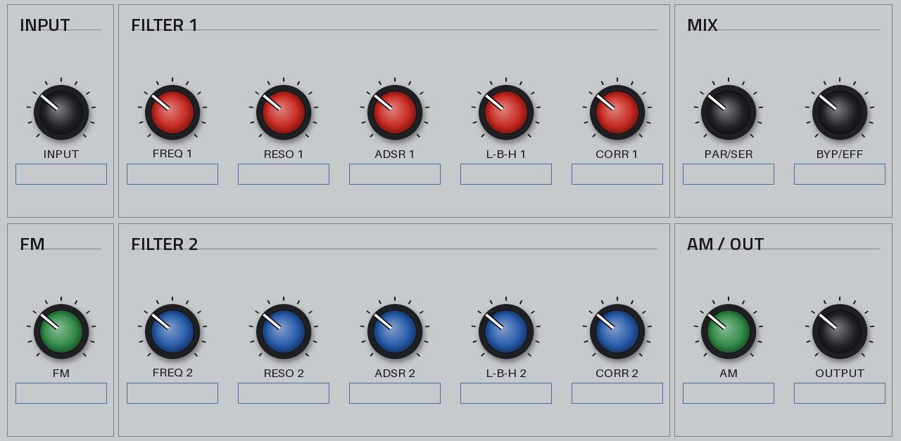
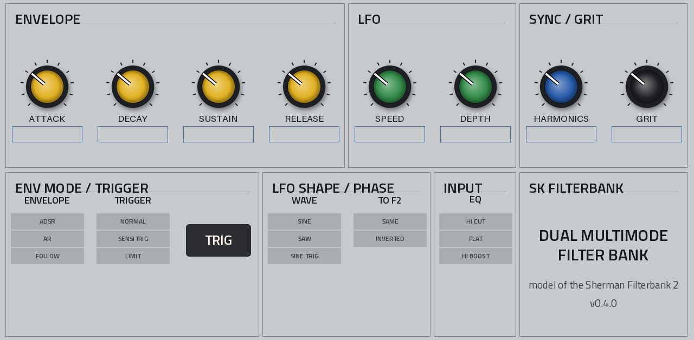
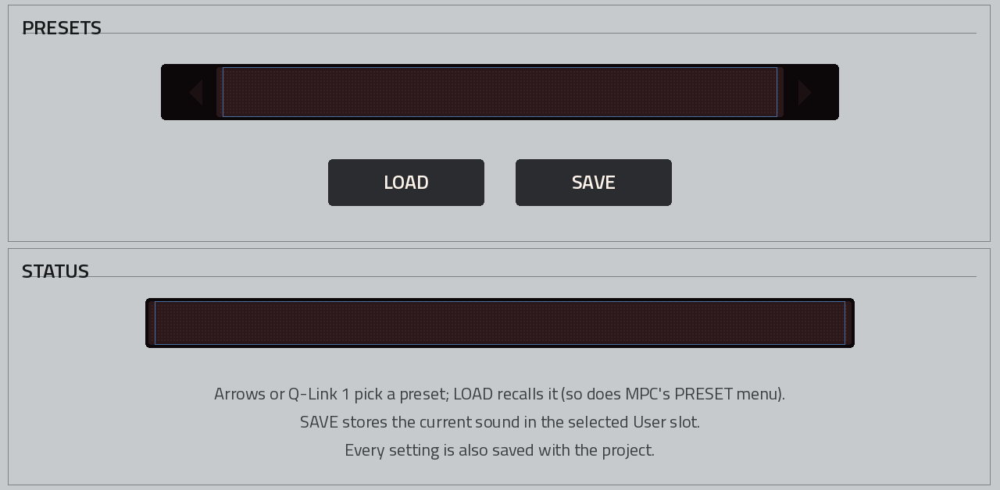

# SK Filterbank on the Akai Force and the other MPCs (MPC OS 3.x)

The filter runs on the MPC as a **native insert effect**, with three touchscreen pages, Q-Links, presets in MPC's
PRESET menu, and its full state saved with your project. MPC OS has a standard VST2 host built in. How a plugin gets
onto the device depends on your MPC OS version:

| Your MPC OS | Download | What it needs |
|---|---|---|
| **3.10.1 or later**, any MPC (Force, Live, One, X, Key, and the 64-bit ones) | [`SK-Filterbank-0.4.0-mpc-sdk.zip`](../dist/SK-Filterbank-0.4.0-mpc-sdk.zip) | Nothing extra: Akai's official external plugin support |
| **3.10.0 or older**, Force and the other Gen1 MPCs | [`SK-Filterbank-0.4.0-mpc-armv7.zip`](../dist/SK-Filterbank-0.4.0-mpc-armv7.zip) | Root over SSH, from MockbaMod |

What Akai published, and what it means here:
- **The MPC Plugin Builder SDK** (MIT licence). It documents what MPC OS's plugin host does (threads, load sequence,
  parameters, state) and the plugin folder format that MPC OS 3.10.1 loads from `VST2 Plugins` folders. This plugin
  follows that host contract and ships in that folder format, with both an armv7 and an arm64 build.
- **A source release of the device's open-source (GPL) Linux parts.** MPC OS itself, the application with the plugin
  host, is still closed source.

| FILTERS | MODULATION | PRESETS |
|---|---|---|
|  |  |  |

*Offline previews of the pages. On the device MPC draws the names and values itself (the boxes under the knobs) in
its own font, using the plugin's parameter names, for example "LFO Speed".*

## Install on MPC OS 3.10.1 and later

1. Download `dist/SK-Filterbank-0.4.0-mpc-sdk.zip` and unzip it on a computer.
2. Copy the folder `Sher Khan - VST - SK Filterbank` into a folder named exactly `VST2 Plugins` at the top of a drive:
   an SD card, a USB drive, or the MPC's internal drive (in Computer Mode, or with the MPC's file browser). Create
   `VST2 Plugins` if it isn't there yet.
3. On the MPC: **Preferences > Enhancements**, turn on **Enable Enhancements** and **External Plugin Support**.
4. Restart the MPC. Add **SK Filterbank** (manufacturer *Sher Khan*) to a track's insert effects. The FILTERS /
   MODULATION / PRESETS tabs at the bottom switch pages, and the Q-Links follow the page.

Update: copy the new folder over the old one and restart the MPC. Your User presets (`presets/` in the folder) stay.
Uninstall: delete the folder; projects that used the plugin open without it.

The folder holds `plugin.json` (Akai's manifest), `VST/sk-filterbank-arm32.so` and `VST/sk-filterbank-arm64.so` (MPC
picks the one for its processor), `version.xml` and the skin in `Plugin Skins/`.

## Install on MPC OS 3.10.0 and older (MockbaMod)

You need **MockbaMod** for your firmware (for Force FW 3.5 and later it is distributed through the
[MockbaMod Discord](https://discord.gg/HvNBpArSSa)), which gives SSH/SFTP as root, and a computer on the same network
with `ssh`/`scp` (PuTTY and WinSCP on Windows).

1. Download `dist/SK-Filterbank-0.4.0-mpc-armv7.zip`.
2. **Save your project.** The installer stops MPC and starts it again.
3. Copy the zip to the Force and run the installer:
   ```sh
   scp SK-Filterbank-0.4.0-mpc-armv7.zip root@<force-ip>:/tmp/
   ssh root@<force-ip>
   cd /tmp && unzip -o SK-Filterbank-0.4.0-mpc-armv7.zip && sh SK-Filterbank-0.4.0/install.sh
   ```
   The installer is the community toolkit's tested one
   ([open-mpc/mpc-vst-plugins](https://github.com/open-mpc/mpc-vst-plugins), MIT):
   - It checks the device and stops MPC (the `acvs` or `inmusic-mpc` service).
   - It copies the plugin folder to `/sdcard/Synths/Sher Khan - VST - SK Filterbank/`.
   - It backs up `MPC.settings` (as `MPC.settings.bak-sk_filterbank-<date>` next to it) and adds one entry to MPC's
     plugin list (`pluginList-arm`), refusing to save an edit that isn't valid.
   - It starts MPC again.

   Running it again upgrades in place and **keeps your User presets** (the `presets/` folder).
4. Add **SK Filterbank** to a track's insert effects, as above.

Install on the internal drive (the default). A Force SSD is usually mounted `noexec`; MPC then lists the plugin but
can only show "Load Plugin", because it can't load code from that drive.

If you use MockbaMod's VST scanner (`vstscanner.sh`), it rebuilds the plugin list from the `plugin-meta.xml` files in
the `Synths` folders. This plugin folder has one, so it survives a rescan.

Uninstall:
```sh
ssh root@<force-ip> sh /tmp/SK-Filterbank-0.4.0/uninstall.sh
```
(If `/tmp` was cleared by a reboot, copy and unzip the package again first.) This stops MPC, removes the plugin and its
plugin-list entry (after a backup), and starts MPC. Your `presets/` folder is kept.

## Moving from 3.10.0 to 3.10.1

What the community reported from devices (open-mpc's notes; not checked on a Force with this plugin):
- Updating replaces MockbaMod with Akai's stock system.
- Plugins registered in `MPC.settings` are no longer offered in the plugin browser on 3.10.1. Projects that used them
  still load: by their stored path, or, if that's gone, from a `VST2 Plugins` copy with the same name, manufacturer and
  ID. This plugin's ID, name and manufacturer are the same in both packages, so projects carry over.

So:
1. Before updating MPC OS, upgrade the MockbaMod install to 0.4.0 too. On 3.10.1 MPC has been seen drawing an older
   copy's skin from `Synths` over the `VST2 Plugins` one, so both copies should be the same version.
2. Update MPC OS, then install the `-mpc-sdk` folder as above. The first time it starts with an empty `presets/`
   folder, it picks up your User presets from `/sdcard/Synths/Sher Khan - VST - SK Filterbank/presets/` and keeps a
   copy.
3. The old install can stay for projects that still point at it.

## Your settings and presets

- **With the project, automatically.** Every control is saved in the plugin's state when you save the project or the
  track program, and restored when you load it. The preset you last picked is saved too. MPC re-selecting that preset
  when the project opens doesn't overwrite your tweaks.
- **MPC's PRESET menu** lists the 12 factory sounds and the 16 User slots. Picking one loads it. Picking the one that
  is already selected does nothing (that protects a project's tweaks), so to go back to a preset after tweaking it,
  press LOAD on the PRESETS page.
- **During playback**, a preset (from the menu or LOAD) crossfades from the old sound to the new one in 30 ms. If you
  pick another one within those 30 ms, it follows straight after. A project load still applies at once.
- **PRESETS page:**
  - The arrows (or Q-Link 1) pick a preset, and **LOAD** recalls it.
  - **SAVE** stores the current sound in the selected User slot. Factory presets are read-only, and the status line
    says what happened.
  - User presets are small text files, `user_01.skfb` to `user_16.skfb`, in `presets/` inside the plugin folder:
    `<drive>/VST2 Plugins/Sher Khan - VST - SK Filterbank/presets/` or `/sdcard/Synths/Sher Khan - VST - SK
    Filterbank/presets/`. Back them up or copy them to another MPC like any file.
  - The 16 slots are shared by every SK Filterbank in the project: a sound saved on one track loads on another.
- **MPC's own plugin presets** (the plugin window's save, `.xpl` files in `Plugin Presets`) also hold the full state.
  They name the plugin's file path, so they belong to one install: the `VST2 Plugins` copy or the MockbaMod one.

Factory presets: Init, Acid Squelch, Funk Follower, Twin Notch Sweep, Stereo Wobble, Vowel Bank, Drum Crusher,
Screaming Ring, Audio FM Growl, Sub Rumble, Harmonic Pluck, Slow Motion.

## What's new in 0.4.0

Projects and User presets from 0.2.0 to 0.3.1 load unchanged; the controls are the same.

- **MPC OS 3.10.1's official plugin support.** A second package in Akai's plugin folder format, with builds for both
  processors, so it runs on every MPC with 3.10.1 or later, no root needed. The MockbaMod package stays for 3.10.0 and
  older.
- **Checked against Akai's published host contract, and fixed where it didn't hold.** The host test now runs the
  documented load sequence, every buffer size from 1 to 512 frames, 200 random sounds through the project state, and
  every truncation of a saved state plus random junk.
  - **No volume burst from MPC's parameter-0 nudge.** MPC sets a plugin's first parameter (here Input) to its end
    and straight back whenever it prepares the plugin; on 3.9.1 it was also seen doing that on STOP. When a nudge
    spans one buffer of running audio, 0.3.1 jumped by +21 dB for that buffer (in the test). Now an end value only
    counts once it has stayed for a buffer.
  - **SAVE and LOAD no longer touch the drive on the audio thread.** MPC delivers screen buttons there; a slow SD
    card could have caused a dropout. The User slots now live in memory and the file is written a moment later,
    outside the audio thread.
  - **The PRESET menu should stay open while you browse.** 0.3.1 asked MPC for a full page refresh after every pick,
    which the community found closes that menu. Refreshes now only happen when a text changed that MPC can't see
    otherwise (not verified on a device).
  - **One tap, one step.** On a Live III the community saw one tap arrive twice, 30-140 ms apart (finger down and
    up), which would make NEXT, PREV or TRIG fire twice. A repeat within 250 ms now does nothing.
  - **Q-Links turn switches the right way.** On an MPC One+ the community measured that about a third of Q-Link ticks
    start from the host's own last value instead of the plugin's. Simulating that, 16 of 104 ticks went the wrong way
    in 0.3.1; now none do. A fast sweep lands on the nearest position instead of crawling one at a time.
  - Value texts fit under the knobs (at most 8 characters): "L>B 45%", "+BP 30%" / "-BP 30%", "30s/cyc".
- **Better sound: the top end stays open.** With both filters wide open, 0.3.1 took 0.24 dB off at 10 kHz and
  0.95 dB at 18 kHz, while the dry path is flat. Most of that came from the overdrive's anti-aliasing (a two-sample
  average at 4x). A short linear-phase filter now puts it back: 0.11 dB at 10 kHz, 0.51 dB at 18 kHz, the rest being
  the filters themselves at their 40 kHz maximum. The reported latency goes from 36 to 38 samples (0.86 ms).
- **Less CPU where it matters.** Instructions per buffer, counted on the armv7 build under emulation, both versions
  with the same harness (it now prepares its test signal beforehand, so these figures are lower than the ones
  published with 0.3.1, which included the signal's own cost):

  | Sound | Buffer | 0.3.1 | 0.4.0 | Change |
  |---|---|---|---|---|
  | Silence (asleep) | 128 frames | 6,221 | 2,850 | -54% |
  | Silence (asleep) | 32 frames | 2,525 | 1,782 | -29% |
  | Init | 32 frames | 42,122 | 41,691 | -1.0% |
  | Init | 128 frames | 162,377 | 163,377 | +0.6% |
  | Screaming Ring | 128 frames | 171,990 | 172,929 | +0.5% |
  | Acid Squelch | 128 frames | 199,987 | 202,820 | +1.4% |
  | Drum Crusher | 128 frames | 209,314 | 210,006 | +0.3% |
  | Audio FM Growl | 128 frames | 217,097 | 219,248 | +1.0% |

  - Asleep in silence (most tracks, most of the time) it costs about half as much as 0.3.1.
  - Settings that only change when you move a knob are no longer worked out again on every buffer, which matters
    most with MPC's small 32-frame buffers.
  - The armv7 build now uses NEON and VFPv4 throughout (as Akai's SDK does), not only in the DSP's NEON code. That
    doesn't change the instruction count, but gives the compiler twice the floating-point registers.
  - Playing, the flatter top end costs about 1.6%. The savings win that back with 32-frame buffers, not quite with
    128-frame ones (+0.3% to +1.4%).

Measured and left alone: audio-rate FM and LFO are clean (inharmonic content 86-92 dB down), and filter 2's
self-oscillation stays within 5 cents of the knob up to 3.5 kHz (20 cents sharp at 12 kHz). Pushed to +40 dB, the
overdrive's aliasing on a 5 kHz tone is 45 dB down (61 dB at +20 dB). Running the overdrive at 8x would gain about
12 dB there, for about 20% more CPU.

## What's new in 0.3.1

Less CPU. Controls and saved state unchanged.
- **Sleep in silence.** After 256 samples (6 ms) of input under -140 dBFS, once the output has died away under
  -90 dBFS and nothing can sound by itself (no self-oscillation, envelope at rest, no knob gliding), it outputs exact
  silence and skips the DSP. Any input, knob change or TRIG wakes it at once.
- **NEON 32 samples at a time** instead of one, including every case of the overdrive's anti-aliasing.
- **One sound change: grit's clock bleed is heard only while the clock is audible** (cutoffs under about 200-400 Hz).
  Above that the real chip's clock is ultrasonic, and the plugin's square wave only aliased down into a faint whine.

## What's new in 0.3.0

Less CPU (57% fewer instructions than 0.2.0 with NEON; no divisions on the audio path), no clicks from LIMIT,
HARMONICS, LFO F2 or the LFO shape during playback, preset crossfades, smoother knobs (cutoffs glide over 30 ms).
Sound: the output safety limiter is exactly linear up to 0 dBFS; with LIMIT on, AM and the clock bleed sound as with
it off; a little less aliasing at high drive.

## The controls

The controls follow the Filterbank 2's front panel as its manual excerpts and reviews describe it. Each page row is one
Q-Link bank (Force knobs 1-8).

**FILTERS page**

| Bank | Knobs 1-8 |
|---|---|
| 1 | Input, Freq 1, Reso 1, ADSR 1, L-B-H 1, Corr 1, Par/Ser, Byp/Eff |
| 2 | FM, Freq 2, Reso 2, ADSR 2, L-B-H 2, Corr 2, AM, Output |

**MODULATION page**

| Bank | Knobs 1-8 |
|---|---|
| 1 | Attack, Decay, Sustain, Release, LFO Speed, LFO Depth, Harmonics, Grit |
| 2 | Env Mode, Trig Mode, –, LFO Shape, LFO F2, Input EQ, –, – |

On the MODULATION page the bottom-row switches step one position per Q-Link click, and the TRIG button sits between
them.

| Control | What it does |
|---|---|
| Input | -30 dB to +40 dB, unity at noon. Past noon it saturates, then distorts. It is also the trigger sensitivity, as on the unit |
| Input EQ | Hi Cut / Flat / Hi Boost shelf at 2.5 kHz, before the drive |
| Freq 1 / 2 | 20 Hz to 40 kHz |
| Reso 1 / 2 | Filter 1 only just reaches self-oscillation ("partial", as the manual says). Filter 2 screams from about 88% |
| ADSR 1 / 2 | Envelope depth: filter 1 0 to +6 octaves, filter 2 bipolar ±6 octaves |
| L-B-H 1 / 2 | Continuous lowpass > bandpass > highpass ("L>B 40%" is 40% of the way from LP to BP) |
| Corr 1 / 2 | Correction: left adds band-pass ("+BP"), centre is off, right subtracts it and adds LP+HP ("-BP"), so BP + full right is a notch |
| Par/Ser | Continuous blend from parallel (1 + 2) to serial (1 into 2) |
| Harmonics | Free, or filter 2 locked to filter 1 at 1:1, 2:3, 1:2, 1:3, 1:4, 1:5, 1:6, 1:8, 1:10, 1:12, 1:16. Freq 2 then reads "Locked" |
| Attack / Decay / Sustain / Release | 1 ms-5 s / 5 ms-10 s / bipolar ±100% / 5 ms-10 s |
| Env Mode | ADSR (held while the input is above the trigger level), AR (one shot per trigger), Follow (envelope follower; Sustain sets its sensitivity) |
| Trig Mode | Normal; SensiTrig (twice as sensitive); Limit (gives the filters 6 dB more headroom when the input is overdriven) |
| TRIG | Fires the envelope by hand (and restarts a Sine Trig LFO) |
| LFO Speed / Depth | One cycle a minute ("60s/cyc") up to 3 kHz (audio rate) / bipolar ±4 octaves |
| LFO Shape / LFO F2 | Sine, Saw, Sine Trig (restarts on each trigger) / filter 2 moves with filter 1 or opposite |
| FM | The input audio sweeps both cutoffs |
| AM | The output is amplitude-modulated by filter 2's output (try it with Reso 2 self-oscillating) |
| Byp/Eff | Dry/wet. The dry signal is delay-compensated, so there's no comb filtering |
| Output, Grit | Plugin additions: output level, and how much of the switched-capacitor sampling (below ~1.7 kHz cutoff) and clock bleed (below ~400 Hz, where the clock is audible) you hear |

The plugin reports 38 samples (0.86 ms) of latency: the 4x oversampling filters and the top-end compensation.

## Built and checked so far

| Check | Result |
|---|---|
| DSP tests (`make test`; under qemu on the armv7 and arm64 builds) | 50/50 (51 on ARM, with NEON against the plain path, which agree to -110 dB on armv7 and -114 dB on arm64): unity at noon, flat open path, filter slopes, notch, resonance, self-oscillation, harmonic lock, Par/Ser, Hi Cut/Boost, ADSR/AR/follower, SensiTrig, TRIG, LFO rate, AM and FM sidebands, grit, aliasing, no clicks, sleep and waking, NaN safety, stress |
| VST2 host test, x86 and **both real ARM binaries under qemu** (with and without NEON) | 68/68: the documented MPC load sequence, parameter-0 nudges, every block size from 1 to 512 frames, in place, value texts and their length, switches under simulated Q-Link turns, double taps, the PRESET menu without page refreshes, user presets (no file access on the audio thread, shared between instances, written on the UI thread, read back by a fresh process, picked up from a legacy install), buttons springing back, project state (200 random sounds, every truncation of a real chunk, random junk), crossfades without a click |
| Binaries | armv7 hard-float with NEON and arm64; each exports only `VSTPluginMain`, needs only libc and libm, highest glibc symbol 2.29 (Akai's SDK targets 2.31; MPC OS 3.10.1 has 2.39) |
| Plugin folder | `mpc/check_folder.py`, written from Akai's folder format and its validator's rules (name, `plugin.json`, both binaries, `version.xml`, skin parameter handles, Q-Links, exFAT-safe names): passes for both packages |
| Installer (MockbaMod package) | install, upgrade and uninstall under BusyBox 1.36.1 against a mock `MPC.settings` in 0.3.1; the installer generator is the same pinned toolkit commit, not re-run for 0.4.0 |
| CPU | see the table above. **Not timed on a device** |

**Not verified:**
- Loading on a real MPC, either route. The `VST2 Plugins` route in particular is checked against Akai's documentation
  and the community's device reports, not on hardware.
- The pages and knob art on the real screen, the PRESET menu and project reload on the device.
- CPU on the RK3288 (or on the arm64 MPCs).
- The sound and the panel colours against a real Filterbank 2. The knob colours are a guess at its function coding;
  edit `KNOB_COLOURS` in `skin_post.py` to change them.

On MockbaMod, please run the device CPU check before relying on several instances:

```sh
MPC_VST=../mpc-vst-plugins mpc/bench.sh <force-ip>       # PASS / WARN / FAIL, nothing is installed
```

Read its "idle" and "audio in" rows for the plugin's own cost (the bench feeds noise even in "idle", so it never
shows the sleep in silence). Its sweep rows set random parameters every block, including LOAD and SAVE, so they also
time preset crossfades, where two sounds run side by side.

## Troubleshooting

- **3.10.1: not in the plugin list.** Check that both switches in Preferences > Enhancements are on, that the folder
  sits directly in `VST2 Plugins` at the top of the drive with its name unchanged, and restart the MPC (a rescan alone
  doesn't update the browser).
- **3.10.1: the plugin loads but shows plain sliders.** The skin wasn't found: the folder name must stay exactly
  `Sher Khan - VST - SK Filterbank`. An older copy of the folder under `Synths` can also hide the new skin; remove it.
- **MockbaMod: listed, but only "Load Plugin".** Usually installed on a `noexec` drive. Reinstall to the default
  `/sdcard/Synths`.
- **MockbaMod: gone from the list after a restart.** Something rewrote MPC's plugin list, for example an edit made
  while MPC was running, or a tool that rebuilds the list. Run `install.sh` again.
- **Changed the skin?** MPC caches skins, so restart MPC (re-inserting the plugin is not enough).
- **The status line says "Could not write User NN to disk".** The plugin folder isn't writable (a read-only drive or
  location). The sound stays saved for this session; move the folder to a writable drive to keep it.
- **MPC crashes when the plugin loads.** On 3.10.1, remove the folder from `VST2 Plugins`. On MockbaMod, SSH in and run
  `uninstall.sh` (or restore the `MPC.settings` backup). Please open an issue with the MPC OS version.

## Rebuilding

```sh
sudo apt install g++-arm-linux-gnueabihf g++-aarch64-linux-gnu qemu-user python3-pil zip   # Debian/Ubuntu
git clone https://github.com/open-mpc/mpc-vst-plugins ../mpc-vst-plugins
git -C ../mpc-vst-plugins checkout 3a54b72cd172c840881b0be4f887653cc0829bf0
mpc/build.sh 0.4.0    # tests (x86, armv7 and arm64), binary checks, skin, both zips in dist/
```

Files:
- `sk_vst.cpp`: the VST2 wrapper (float audio, hand-written ABI, presets, state, the host-contract handling).
- `params.json` and `layout.conf`: the pages and Q-Links.
- `skin_post.py`: the colour-coded knobs and page texts.
- `check_params.py`: keeps the files above in step with the plugin, since saved projects bind parameters by index.
  Never reorder them, only append.
- `check_folder.py`: checks a built plugin folder against Akai's folder rules.
- `build.sh` and `bench.sh`: the build and the device CPU check.
