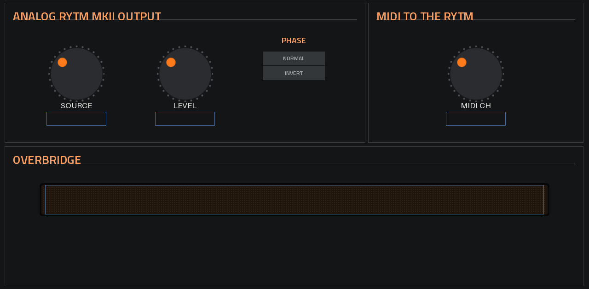
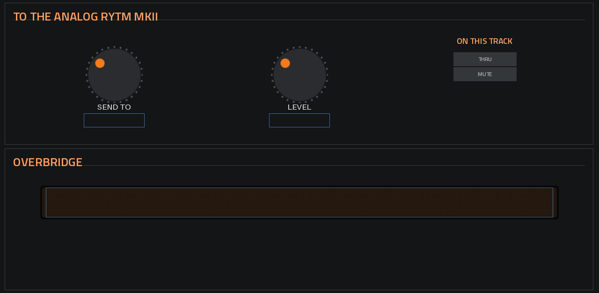

# SK Rytm: Overbridge for the Analog Rytm MKII on the Akai Force and the other MPCs

**Read this first: not yet run with a real Analog Rytm on a real MPC.** Everything up to the USB cable is tested
(below); the USB conversation with the AR follows the protocol documented by the Overwitch project, which has run
on Linux with the AR MKII for years, but this implementation has not talked to an AR yet. The first session on your
Force is the real test: check the status line (see *Troubleshooting*).

Two plugins, sharing one Overbridge connection to the AR:

| Plugin | Type | What it does |
|---|---|---|
| **SK Rytm Track** | instrument (plugin track) | Plays **one of the AR's 12 Overbridge outputs** on its own MPC track: Main L/R, **BD, SD, RS/CP, BT, LT, MT/HT, CH/OH, CY/CB**, Input L/R (and the single sides). Optionally forwards the track's MIDI to the AR. |
| **SK Rytm Send** | insert effect | Sends a track's audio into **one of the AR's 12 Overbridge inputs**: Main In, FX In, or a track's input. Thru (you still hear it on MPC) or Mute (only the AR gets it). |

| SK Rytm Track | SK Rytm Send |
|---|---|
|  |  |

*Offline previews; on the device MPC draws the value texts (SOURCE: "BD", the status line) itself.*

So each AR voice gets its own MPC track, with MPC's mixer, **insert effects (the Force's own compressor, EQ,
reverb...), sends, submixes and sidechains**. All the SK Rytm tracks are **sample-aligned** with each other, so
parallel compression (two tracks on the same output) and ducking work without phase problems.

## What it covers of Overbridge, and what not

| Overbridge feature | SK Rytm 0.1.0 |
|---|---|
| Multitrack audio from the AR (12 channels, 48 kHz) | **Yes**, resampled to MPC's fixed 44.1 kHz, drift-tracked |
| Audio to the AR (12 channels) | **Yes** (SK Rytm Send) |
| Tracks aligned with each other | **Yes**, sample-exact (tested) |
| Latency compensation | The Track reports its latency (about 6 ms) to MPC. Whether MPC OS uses it is not documented |
| MIDI | Native: MPC sees the AR's MIDI port in Overbridge mode (MIDI tracks, clock). Plus, optionally, the Track forwards its own MIDI to the AR (best effort, see below) |
| Tempo/transport sync | Through MIDI clock from MPC (MIDI settings), as with any external device. Not over the audio stream |
| **Parameter editor** (the Overbridge plugin window: kit and sound pages, automation of every AR parameter, total recall) | **No, not in this version.** The AR's parameters are reachable over MIDI CC/NRPN from MPC's MIDI tracks today; a dedicated editor page is the next step |
| Sample transfer | No (that is Elektron Transfer, not Overbridge) |

## Requirements

- **Analog Rytm MKII** with an OS that has Overbridge, set to Overbridge USB mode (on the AR: SETTINGS > SYSTEM >
  USB CONFIG, choose OVERBRIDGE), connected to the MPC's **USB host port** (USB-A).
- **MPC OS 3.10.1 or later** (official external plugins), or **3.10.0 / older with MockbaMod** (root).
- The plugin opens the AR directly through Linux USB (`/dev/bus/usb`). MPC runs as root on MockbaMod, so that works
  there. On a stock 3.10.1 it should too (MPC OS runs MPC as root as far as the community has seen), but that is not
  confirmed: if the status says **"No USB access (needs root)"**, that is the reason.

### Track count

- **MPC OS 3.10.1**: Akai's release notes list "unlimited audio and plugin tracks" as an experimental enhancement
  (Preferences > Enhancements); before it, the limit was 8 unique plugin programs. With all 8 AR outputs plus Main
  you need 9+ plugin tracks, so turn that enhancement on. Akai warns that many tracks can exceed the CPU or memory.
- **3.10.0 with MockbaMod**: not verified here. If MPC refuses a 9th plugin track, you are limited to 8.

### Memory and CPU (estimated from the code, not measured on a device)

- One engine for everything: about **0.5 MB** (two 85 ms ring buffers of 12 channels, the resampling tables), plus a
  USB thread and a MIDI thread.
- Each SK Rytm Track: a few KB. Each SK Rytm Send: about 50 KB.
- CPU per Track: a 32-tap resampler on one channel (two for Main L/R and Input L/R): about 1.4 million
  multiply-adds per second per channel, a small fraction of one Force core. The USB thread decodes 12 channels at
  48 kHz. **Not timed on the RK3288 yet.**

## Install

**MPC OS 3.10.1 and later:** unzip `dist/SK-Rytm-0.1.0-mpc-sdk.zip`, copy both folders into `VST2 Plugins` at the
top of a drive, turn on Preferences > Enhancements > Enable Enhancements and External Plugin Support (and the
unlimited tracks enhancement), restart. Details: `INSTALL.txt` in the zip.

**MPC OS 3.10.0 and older (MockbaMod):** the same as SK Filterbank's MockbaMod route
([mpc/README.md](../mpc/README.md#install-on-mpc-os-3100-and-older-mockbamod)), once per plugin:

```sh
scp dist/SK-Rytm-Track-0.1.0-mpc-armv7.zip dist/SK-Rytm-Send-0.1.0-mpc-armv7.zip root@<force-ip>:/tmp/
ssh root@<force-ip>
cd /tmp && for p in Track Send; do unzip -o SK-Rytm-$p-0.1.0-mpc-armv7.zip && sh SK-Rytm-$p-0.1.0/install.sh; done
```

Each installer backs up `MPC.settings`, adds one plugin-list entry and restarts MPC. Projects carry over to the
3.10.1 route later (same names, vendor and IDs).

## Using it on the Force

1. Set the AR to Overbridge mode and plug it in. Add a **plugin track** with **SK Rytm Track** (Sher Khan). The
   status line shows **"AR MKII streaming 5.6 ms"** once it has found the AR.
2. Turn **SOURCE** (Q-Link 1) to the AR output, or pick it in MPC's PRESET menu (the presets are the outputs: BD,
   SD...). One track per AR output.
3. Name the tracks, add effects as on any track.

Recipes:
- **Separate tracks:** 8 tracks (BD ... CY/CB). On the AR, the voices sent to their own track outputs are removed
  from Main according to the AR's own routing settings; use **Main L/R** on a 9th track for what stays there (and
  the AR's FX).
- **Parallel compression:** a second SK Rytm Track on the same SOURCE with a heavy compressor, mixed under the dry
  one. They are sample-aligned, so no comb filtering. (Or MPC's sends/returns from the one track.)
- **Ducking:** the Force compressor on the bass/pad tracks, sidechain from the BD track.
- **Phase INVERT:** checking alignment (BD + BD inverted = silence) or fixing a polarity in a parallel chain.
- **Send:** put **SK Rytm Send** on any MPC track, SEND TO = **FX In** to run it through the AR's delay/reverb, or
  a track input to process it with that track. Return it with a Track on Main L/R. MUTE keeps it off MPC's mix.

**MIDI CH** (Track): Off by default. Set it to the AR track's MIDI channel and the track's pads and sequence are sent
to the AR on that channel. This goes through the Linux MIDI sequencer to the AR's USB MIDI port; if MPC already holds
that port exclusively, the status shows "MIDI busy" and you use an ordinary MPC MIDI track with the AR as output
instead (that always works).

## Troubleshooting (the status line)

| Status | Meaning |
|---|---|
| `AR MKII streaming 5.6 ms` | Running. The number is the input buffer; the total from the AR to MPC is about that plus a ms |
| `AR MKII 7.4 ms, 3 xruns` | The AR's data arrived late a few times; the buffer grew by itself to stay clean. A few at start-up are normal; a count that keeps rising means USB or CPU trouble |
| `Connect AR MKII (Overbridge)` | No AR MKII on USB. Check the cable (host port), and USB CONFIG = OVERBRIDGE on the AR |
| `AR busy: used by another app` | Something else has the AR's Overbridge interfaces open |
| `No USB access (needs root)` | MPC is not allowed to open `/dev/bus/usb`: see Requirements |
| `USB error N, retrying` | Linux error N while setting the AR up; it retries every second |
| `MIDI busy` / `MIDI: no AR` / `no MIDI` | MIDI forwarding: MPC holds the port / no Rytm MIDI port seen / no sequencer |

The audio of every track goes silent (not noisy) while the AR is unplugged or out of Overbridge mode, and comes back
by itself.

## How it works

- `rytm/ob_core.h`: the shared timeline and buffers. Every MPC audio period, the first SK Rytm instance to run
  (whichever MPC worker thread it is on) decides which span of the AR's 48 kHz stream the period covers, continuing
  the previous one exactly; every other instance in that period uses the same span. A PI loop keeps the input
  buffer at its target and so tracks the AR's crystal against MPC's. 32-tap windowed-sinc resampling both ways.
- `rytm/ob_usb.h`: the USB thread (usbfs, interrupt transfers on endpoints 0x83/0x03, interfaces 1 and 2 at alt
  setting 3), the MIDI thread (ALSA sequencer kernel interface), and the one-engine-per-process rendezvous: SK Rytm
  Track and SK Rytm Send are separate `.so` files, so the first one creates the engine and the other finds it through
  `/dev/shm/sk-rytm-<pid>-...`. Both are linked `-z nodelete` so the code the threads run stays loaded.
- `rytm/rytm_vst.cpp`: the two VST2 plugins (one source, `-DSK_RYTM_SEND` for the Send).
- The binaries need only libc, libm and libpthread, highest glibc symbol 2.27 (MPC OS 3.10.0 has 2.32, 3.10.1 has
  2.39), and export only `VSTPluginMain`.

## Built and checked

| Check | Result |
|---|---|
| Engine simulation (`make rytm-test`, also under qemu for armv7 and arm64) | A simulated AR at -300 to +300 ppm against MPC's clock, USB jitter up to 1.2 ms, block sizes 32 to 512, 3 to 12 instances in random order: **no xruns once locked, every instance on the same span, resampling error -82 dBFS**; clock correction within 40 ppm of the truth. A new instance joining mid-period; an instance skipped then back; the AR unplugged and back (silence, then clean resync); instances placed a block off at the worst moment are realigned within 4 blocks while MPC plays. 4 real threads x 3 instances for 20000 periods: all on the shared span. Send path: -91 dBFS error, no missing samples |
| Resampling | Flat to 10 kHz (±0.01 dB), -0.5 dB at 18 kHz; content between 22.05 and 24 kHz folds back at -45 dB (above 21 kHz) to -90 dB |
| VST2 host test (`tests/test_rytm_vst.cpp`) against the real `.so` files, x86 and both ARM builds under qemu | MPC's load sequence, the parameter-0 nudge, names and value texts, programs, chunks (round trip, every truncation, 200 junk chunks), every block size 1-512, one engine shared by the two `.so` files, then **3 s in real time against the engine's simulated AR**: BD and SD tracks play their outputs at the right level, **a BD track plus a BD-inverted track sum to -240 dBFS (exactly aligned)**, Input at -6 dB, the Send reaches the AR at the right level, Thru passes audio bit-exact, Mute silences |
| Plugin folders | `mpc/check_folder.py` (Akai's folder rules) passes for both; the toolkit's `catalog_check.py` passes both MockbaMod zips |
| Binaries | armv7 hard-float NEON and arm64; exports only `VSTPluginMain`; libc, libm, libpthread; highest glibc symbol 2.27 |

**Not verified:**
- Anything with a real AR MKII over USB: the device setup sequence, the transfer sizes the AR accepts on the
  Force's USB controller, the AR's channel order (taken from Overwitch).
- Loading on a real MPC (either route), MPC's USB permissions on stock 3.10.1, MIDI forwarding next to MPC's own
  use of the AR's MIDI port, whether MPC compensates the reported latency.
- Loading against glibc 2.31/2.32 at run time: checked statically (symbol versions), not by running the old loader.
- CPU and memory on the device.

## Testing without an AR

`SK_RYTM_SIMULATE=1` in MPC's environment (or the test host's) replaces the USB connection with a virtual AR:
each output plays a sine (220 Hz x (channel + 1)), and the Send's status shows the level the virtual AR receives.

```sh
make rytm-test          # engine simulation + host test, x86
make rytm-test-arm      # the same against the armv7 and arm64 builds (qemu-user)
MPC_VST=../mpc-vst-plugins rytm/build.sh   # everything + skins + the three zips in dist/
```

Credits: the Overbridge protocol as documented by [Overwitch](https://github.com/dagargo/overwitch)
(`rytm/NOTICE-overwitch.txt`). Not made or endorsed by Elektron or Akai.
