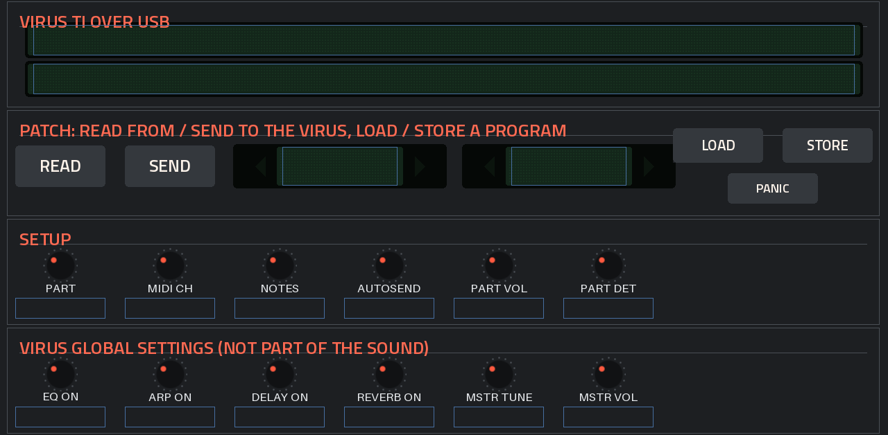
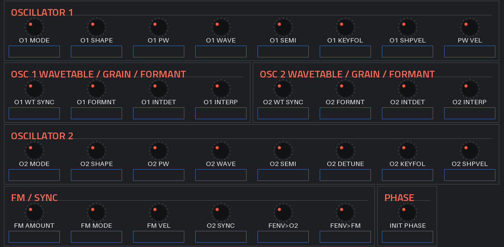

# SK TI Link: an Access Virus TI / TI2 over USB on the Akai Force and the other MPCs

## En bref (français)

- **Le Virus TI passe en USB pour le MIDI seulement, pas pour l'audio.** MPC OS est un Linux. Linux a un pilote pour
  le MIDI USB du Virus TI (ID USB 133e:0815), mais aucun pour son audio USB, qui utilise un protocole propre à Access.
  Le son revient donc par les sorties analogiques du Virus, branchées sur les entrées de la Force, et s'écoute sur une
  piste audio.
- Le plugin est un **instrument VST2** pour MPC OS. Il ne produit aucun son lui-même : il pilote le Virus.
  - Les **373 paramètres d'un Single** sont sur 15 pages et sur les Q-Links : oscillateurs (Classic, HyperSaw,
    Wavetable, Grain, Formant), filtres, enveloppes, LFO, matrice de modulation, effets, arpégiateur et ses 32 pas.
  - **READ / SEND / LOAD / STORE** : lire le Virus, lui envoyer le son, charger ou écrire un programme de ses banques.
  - Le son est **sauvé avec le projet** et renvoyé au Virus à l'ouverture du projet.
  - Les **notes de la piste** sont envoyées au Virus, sur le canal MIDI choisi.
  - Mode Single ou une des **16 parts** d'un Multi, plus les réglages globaux (EQ, Arp, Delay, Reverb, volume, accord).
- **Deux paquets, comme pour SK Filterbank :**
  - MPC OS **3.10.1** : [`SK-TI-Link-0.1.0-mpc-sdk.zip`](../dist/SK-TI-Link-0.1.0-mpc-sdk.zip), à copier dans `VST2 Plugins`.
  - MPC OS **3.10.0** avec MockbaMod : [`SK-TI-Link-0.1.0-mpc-armv7.zip`](../dist/SK-TI-Link-0.1.0-mpc-armv7.zip), installé en SSH.
- **Jamais essayé avec un vrai Virus ni sur une vraie Force.** Tout le protocole est testé contre un faux Virus logiciel,
  sur x86 et sur les deux binaires ARM émulés. Voir *Ce qui est vérifié*.

The rest of this page is in English, like the rest of the repository.

## What it is, and what it can't be

| | |
|---|---|
| **USB MIDI** | Yes. Linux's `snd-usb-audio` drives the TI's USB MIDI: it sends the TI's "MIDI send enable" command when the TI is plugged in, and creates two ports, *"<name> MIDI"* (the TI's MIDI DIN sockets) and *"<name> Synth"* (the synth). The plugin talks to the synth port. |
| **USB audio** | **No.** The TI streams audio over USB in a protocol of Access's own (Virus Control / TI mode). Linux has no driver for it (the kernel even skips that interface on purpose), and a plugin can't add one. Cable the TI's analog outs (Out 1 L/R) to the MPC's inputs and monitor them on an audio track. |
| **Which TI** | The kernel knows USB ID **133e:0815** ("Virus TI Desktop"). The TI2 most likely uses the same ID, but no source says so. If yours doesn't, the LINK page says *"Virus on USB (133e:xxxx) but MPC OS gave it no MIDI port"*: please report that ID. Without a kernel driver, no plugin can reach it over USB; the TI's MIDI DIN sockets with a USB MIDI interface would then do the same job. |

The plugin:
- **Every parameter of a TI Single**, 373 VST parameters on 15 pages, all on Q-Links (rows 1-2 of a page are its first
  Q-Link sub-page, rows 3-4 its second). Turning one sends the TI's SysEx parameter change at once.
- **Names follow the TI's modes.** Where the TI reuses a byte, the knob is renamed: Osc 1 *Shape* becomes *Density* in
  HyperSaw mode and *Index* in Wavetable / Grain / Formant mode, *Cutoff 1* becomes the vocoder's *Car Freq* when the
  vocoder is on, the delay's knobs become the tape delay's, the filter bank's follow its type, and so on.
- **READ** fetches the TI's edit buffer (all 512 bytes, the patch name too). **SEND** sends the plugin's patch to it.
- **LOAD** fetches *Bank / Program* from the TI's memory and puts it in the edit buffer. **STORE** writes the plugin's
  patch into *Bank / Program*: press it twice within 4 s (the first press says what will be overwritten).
- **Project state:** the patch, the part, the MIDI channel and the global settings are saved with the project. With
  **AutoSend** on (the default), opening the project sends the patch to the TI, as soon as it is connected (also if you
  switch the TI on later). The TI's global settings are never sent on load: they stay the TI's own.
- **Notes, controllers, pitch bend and pressure** from the track go to the TI on **MIDI Ch** (MPC hands a plugin every
  note on channel 1, so the plugin's channel decides). **Notes Off** stops that, for example when a MIDI track already
  plays the TI. **PANIC** (and stopping the plugin) sends note-offs for every note held, sustain off and all-notes-off.
- **Part:** *Single* edits the TI's Single mode edit buffer; *Part 1-16* edits that part of a Multi (with its Part
  Volume and Part Detune).
- **Panel feedback:** if the TI reports a knob you turn on its panel (as SysEx, or as a controller / poly pressure on
  the plugin's channel), the plugin's knob follows. Whether and on which USB port the TI reports them depends on its
  settings; READ always brings everything back in step.

## Install

### MPC OS 3.10.1 and later (any MPC)

1. Unzip `dist/SK-TI-Link-0.1.0-mpc-sdk.zip` and copy the folder `Sher Khan - VST - SK TI Link` into a folder named
   exactly `VST2 Plugins` at the top of a drive.
2. Preferences > Enhancements: turn on **Enable Enhancements** and **External Plugin Support**.
3. Plug the TI's USB port into a USB host port of the MPC, switch the TI on, restart the MPC.
4. Load **SK TI Link** (Sher Khan) as a plugin instrument on a track. The first line of the LINK page tells you whether
   it found the TI.

### MPC OS 3.10.0 and older (MockbaMod)

```sh
scp SK-TI-Link-0.1.0-mpc-armv7.zip root@<force-ip>:/tmp/
ssh root@<force-ip>
cd /tmp && unzip -o SK-TI-Link-0.1.0-mpc-armv7.zip && sh SK-TI-Link-0.1.0/install.sh
```
Same installer as SK Filterbank (the community toolkit's): it stops MPC, copies the folder to
`/sdcard/Synths/Sher Khan - VST - SK TI Link/`, backs up `MPC.settings`, registers the plugin and starts MPC.
Uninstall with `sh /tmp/SK-TI-Link-0.1.0/uninstall.sh`.

To see what MPC OS makes of the TI (USB ID, driver, ports, who holds them): copy `virus/mpc/ti_check.sh` to the MPC
and run `sh ti_check.sh` over SSH.

## Using it

1. **LINK page.** Status line first: *Connected: Virus TI on USB (sequencer ...)* is what you want.
2. Pick **Part** (Single, or the Multi part to edit) and **MIDI Ch** (the channel the TI listens to: its global channel in
   Single mode, the part's channel in Multi mode).
3. Press **READ** to bring the TI's current sound into the plugin. All knobs move to the TI's values and the second line
   shows the patch name.
4. Edit on any page or with the Q-Links. Play from the track.
5. Save the project: the sound is in it. **LOAD** / **STORE** with the Bank and Program steppers work with the TI's
   memory (*Bank A* is sysex bank 1, the TI's first RAM bank; *[Guessing]* the TI2's RAM banks are A-D).

| Page | Rows (one frame per section) |
|---|---|
| LINK | status, patch name / READ, SEND, Bank, Program, LOAD, STORE, PANIC / Part, MIDI Ch, Notes, AutoSend, Part Vol, Part Det / TI globals: EQ, Arp, Delay, Reverb on/off, master tune and volume |
| OSC | Oscillator 1 / Osc 1 and 2 Wavetable-Grain-Formant / Oscillator 2 / FM, Sync, Phase |
| MIX | Oscillator 3, Sub, Noise / Mixer / Unison, Output / Play (transpose, key mode, portamento, smoothing, bender, tempo) |
| FILTER | Filter 1 / Filter 2 / routing, balance, saturation, link, key base, select / filter envelope |
| ENV | Amp envelope / Envelope 3 / Envelope 4 / LFO 3 |
| LFO | LFO 1 / its amounts and assign / LFO 2 / its amounts and assign |
| MOD, MOD 2 | modulation slots 1-6 (source, three destinations and amounts each) / soft knobs / categories |
| FX 1 | Chorus / Phaser / Delay / Tape delay |
| FX 2 | Reverb / Distortion / EQ / Analog Boost, Character, Atomizer |
| FX 3 | Filter bank / Vocoder, Input, Input follower |
| ARP | arpeggiator mode, pattern, octaves, hold, length, swing, clock, user pattern length |
| STEP LEN, STEP VEL, STEP BITS | the user pattern's 32 steps: length, velocity, and the step's flag bits |




*Offline previews. On the device MPC draws the names and values in the boxes itself.*

## How it reaches the TI

- **ALSA sequencer** (`/dev/snd/seq`), the normal way: the plugin is a sequencer client of its own, connected to the TI's
  "Synth" port both ways, so **MPC can keep the TI as a MIDI device at the same time** (a MIDI track can still play
  it). Its own port is hidden from MPC (no subscribe rights, not exported), so MPC never lists it as an input and never
  hears the plugin's notes back.
- **Raw MIDI** (`/dev/snd/midiC<card>D0`, sub-device 1), if the sequencer can't connect. If MPC holds that device
  exclusively, the status says *"The Virus's MIDI port is busy"*: switch the TI's Track / Remote off in MPC's MIDI
  settings and the plugin connects within 2 seconds.
- Both spoken with plain system calls: the binaries need **libc and libm only** (no libasound), as SK Filterbank's do.
- It reconnects by itself when the TI is unplugged and plugged back, or switched on after the project.
- SysEx goes out at about 8 KB/s (2.5 x MIDI DIN speed, far under USB), so nothing overflows the kernel's MIDI buffer.
  After a whole patch, parameter changes wait 250 ms: the TI drops changes that arrive while it takes a patch.
- Fast knob sweeps are coalesced: the TI gets the latest value of each knob, never a backlog.

The Virus SysEx used (Access's format; device ID 0x10 = omni, part 0x40 = the Single edit buffer):

| Message | Bytes |
|---|---|
| Parameter change | `F0 00 20 33 01 10 <page 6E/6F/70/71/72/73> <part> <index> <value> F7` |
| Request a Single | `F0 00 20 33 01 10 30 <bank: 0 = edit buffer> <program or part> F7` |
| Single dump (TI) | `F0 00 20 33 01 10 10 <bank> <program> <256 bytes A+B> <cs> <256 bytes 6E+6F> <cs> F7` (524 bytes; cs = sum from byte 5, 7 bits) |

## Ce qui est vérifié / what was checked

| Check | Result |
|---|---|
| Host test against a fake Virus (`make test`), x86 **and both ARM binaries under qemu** | 1191/1191: identity, every parameter's name (10 characters at most) and value text, parameter-0 nudges, SysEx for parameters / parts / globals, mode-dependent names, Q-Link ticks, notes on the chosen channel, PANIC and release on close, READ (dump applied, every knob reported to the host), SEND (524 bytes, valid checksums, the image read), damaged dump refused, no-answer timeout, panel feedback (SysEx and controller), LOAD, STORE (two presses, disarmed by a program change), project state and AutoSend, a state never read from a TI (sent parameter by parameter), AutoSend off, truncated and junk states refused, a 400-move sweep coalesced |
| Sequencer ABI declared by hand vs the kernel's `<sound/asequencer.h>` | identical: 32-bit (armv7, the Force) and 64-bit |
| Binaries | armv7 hard-float (NEON/VFPv4) and arm64; export only `VSTPluginMain`; need only libc and libm; highest glibc symbol 2.28 (armv7) / 2.17 (arm64) |
| Plugin folders | Akai SDK folder rules and the legacy folder: OK (`mpc/check_folder.py`) |
| Skin | 15 tabs, no overlaps or off-screen controls (the toolkit's skin check) |

**Not verified:**
- **Nothing ran with a real Virus TI or on a real MPC.** The fake Virus follows the protocol as gearmulator implements
  it; the real TI's answers (dump timing, which port it reports panel changes on, bank numbering) are unchecked.
- The ALSA sequencer path: the test machine has no `/dev/snd`, so only the raw-MIDI-style byte path ran end to end.
- **Whether the TI2 has USB ID 133e:0815.** *[Guessing]* it does.
- How MPC's tab strip copes with 15 tabs, and the pages on the real screen.
- Bank letters beyond the TI's RAM banks (ROM banks may be read-only or numbered differently).

## Rebuilding

```sh
python3 virus/gen.py         # after editing PAGES in gen.py or the data: ti_table.h, mpc/params.json, mpc/layout.conf
cd virus && make test         # x86; make test-force / test-arm64 under qemu
virus/mpc/build.sh 0.1.0      # tests, ARM builds, binary checks, skin, both zips in dist/
```

The parameter data (`virus/data/ti_params.json`) was imported once from gearmulator's Virus TI parameter descriptions
with `virus/tools/import_gearmulator.py` (gearmulator is GPL-3.0, so this plugin is GPL-3.0: `virus/LICENSE`). The
mode rules that pick a knob's name and the short names are ours (in that script). VST parameter order: the 17 LINK
controls, then the 373 TI parameters; projects bind by index, so only ever append.

Not made or endorsed by Access Music or Akai. Virus and Virus TI are trademarks of their owners.
